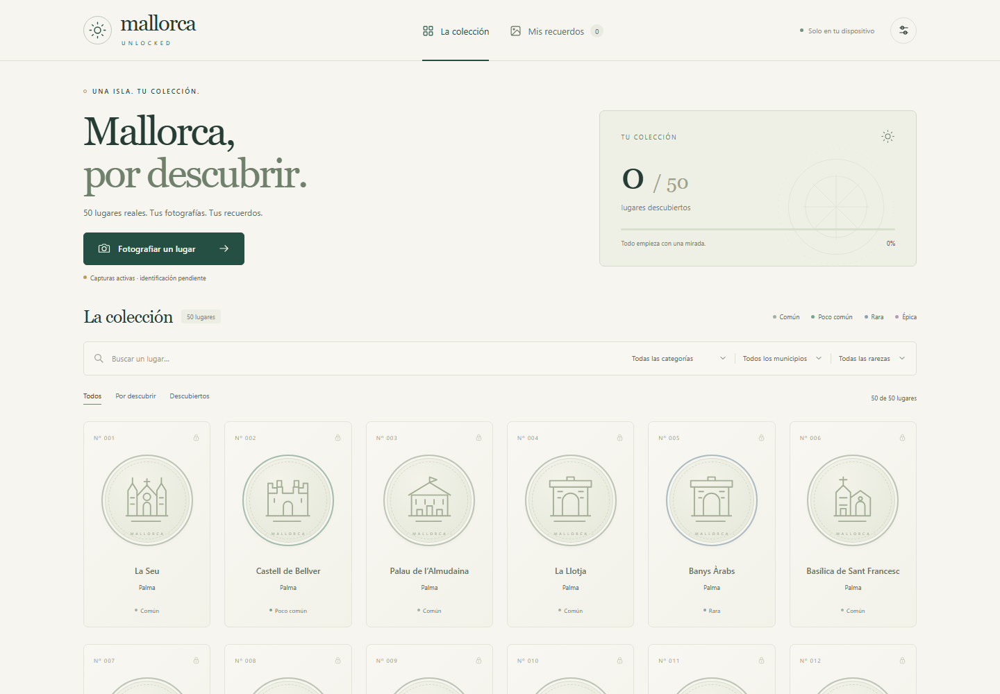

# Mallorca Unlocked

Una colección visual de lugares reales de Mallorca. Las monedas guardan tu fotografía en el reverso después de una identificación visual válida y tu confirmación.

**MVP estático, sin cuentas ni backend.** Incluye 50 lugares documentados de 20 municipios. El objetivo de 300–400 queda pendiente de ampliación. **El reconocimiento de lugares reales todavía no está validado:** puedes tomar y guardar capturas pendientes, pero no se presentan identificaciones simuladas ni se incrementa el progreso con ellas.



## Abrir en local

Necesitas Node.js 22 o posterior. No se requieren claves ni servicios de pago.

```sh
npm ci
npm run dev
```

Abre la dirección que imprime el servidor, normalmente `http://127.0.0.1:5173/`. No abras `index.html` directamente: los módulos y la cámara necesitan un origen servido. `localhost` es un contexto seguro admitido para la cámara; en producción se utiliza HTTPS.

Para probar el resultado empaquetado:

```sh
npm run build
npm run preview
```

`dist/` contiene la web completa. No subas `node_modules/`, copias personales ni fotografías al repositorio.

## Qué funciona realmente

- Cuadrícula responsive de 50 monedas con iconos SVG originales, bordes por rareza, fichas y fuentes documentales.
- Búsqueda sin distinguir tildes y filtros combinados por categoría, municipio, rareza y estado.
- Estados apagado/iluminado, animación de desbloqueo y giro 3D para mostrar la captura personal. Una instalación nueva empieza con **cero** descubrimientos.
- Cámara `getUserMedia`, solo vídeo y fotos nuevas. Sin galería, micrófono ni GPS. Permisos explicados y errores recuperables.
- Capturas JPEG del fotograma completo con fecha, guardadas como `Blob` en IndexedDB. Consulta y eliminación confirmada de capturas pendientes.
- Copias JSON versionadas con fotografías y fechas. Importación revisable, validación previa, transacción atómica, conservación de originales y restauración sin duplicados.
- Solicitud opcional de almacenamiento persistente, navegación con teclado y respeto a movimiento reducido.
- Adaptador real de visión ORB/OpenCV en worker, política de rechazo y propuesta con confirmación. **Desactivado por defecto**, sin referencias ni métricas de campo inventadas.
- Build estático y workflows de verificación y despliegue manual en GitHub Pages. Las rutas relativas se prueban bajo `/MallorcaUnlocked/`.

## Qué está pendiente

El ciclo «foto de monumento real → reconocimiento fiable → moneda» necesita fotografías de referencia con derechos claros y una evaluación independiente con negativos y edificios confundibles. Por ahora, guardar una foto **no desbloquea** un lugar: queda en «Mis recuerdos → Capturas pendientes». No hay modo de juego ficticio ni selección manual presentada como reconocimiento.

También quedan la ampliación documental, las pruebas de campo en Safari/iOS y Android reales, y la validación en dispositivos con poca memoria. No hay sincronización ni carga offline garantizada. El navegador puede eliminar el almacenamiento: exporta copias para conservar tus recuerdos.

## Verificar

```sh
npm ci
npx playwright install chromium
npm run verify
```

En Linux limpio, usa `npx playwright install --with-deps chromium`. Por defecto se usa Chromium de Playwright. La variable opcional `MALLORCA_BROWSER_CHANNEL=chrome` permite elegir el Chrome del sistema.

La verificación comprueba sintaxis y catálogo, ejecuta pruebas de lógica/persistencia, crea `dist/` y prueba el navegador con cámara virtual. Nunca utiliza tu cámara física. Las texturas y copias de prueba no se distribuyen como descubrimientos reales. Las capturas de QA quedan en `.local/qa/`, ignoradas por Git. [Cobertura y límites](docs/VERIFICATION.md).

## Publicar en GitHub Pages

1. Sube el código verificado a este repositorio.
2. En **Settings → Pages → Build and deployment → Source**, selecciona **GitHub Actions**.
3. Abre **Actions → Deploy GitHub Pages → Run workflow** sobre `main`.
4. El workflow verifica antes de desplegar. La URL prevista es `https://aesgalexis.github.io/MallorcaUnlocked/`; no se considera publicada hasta que GitHub confirme el despliegue.

La publicación es manual para revisar el MVP antes de exponerlo. CI se ejecuta con cada push/PR sin desplegar.

**El repositorio proporcionado es privado.** Pages en repositorios privados depende del plan; el plan gratuito admite Pages en repositorios públicos. Si tu plan no lo permite, tendrás que decidir hacer público el repositorio o servir `dist/` en otro alojamiento estático. No se cambia su visibilidad automáticamente. [Disponibilidad oficial](https://docs.github.com/en/pages/getting-started-with-github-pages/using-custom-workflows-with-github-pages), [configuración de Pages](https://docs.github.com/en/pages/getting-started-with-github-pages/configuring-a-publishing-source-for-your-github-pages-site).

## Documentación

- [Catálogo, fuentes y rareza](docs/CATALOG.md)
- [Arquitectura y persistencia](docs/ARCHITECTURE.md)
- [Reconocimiento y validación pendiente](docs/RECOGNITION.md)
- [Verificación realizada](docs/VERIFICATION.md)
- [Dependencias y atribuciones](THIRD_PARTY_NOTICES.md)

No se ha elegido una licencia general para el código en nombre de su propietario. Los componentes de terceros conservan sus respectivas licencias.
